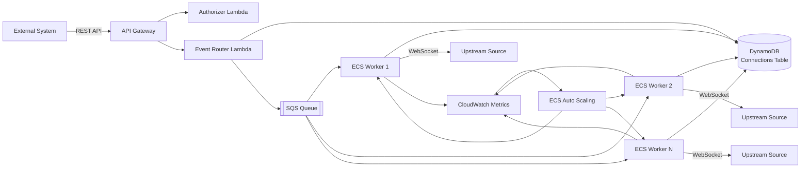
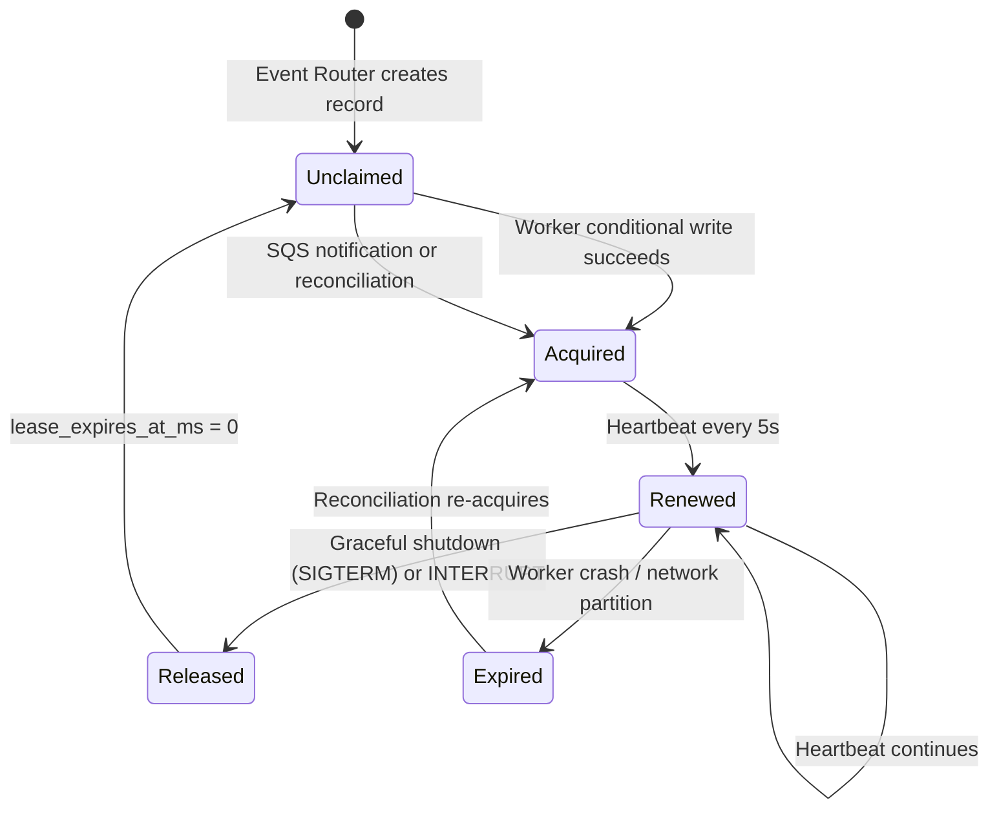
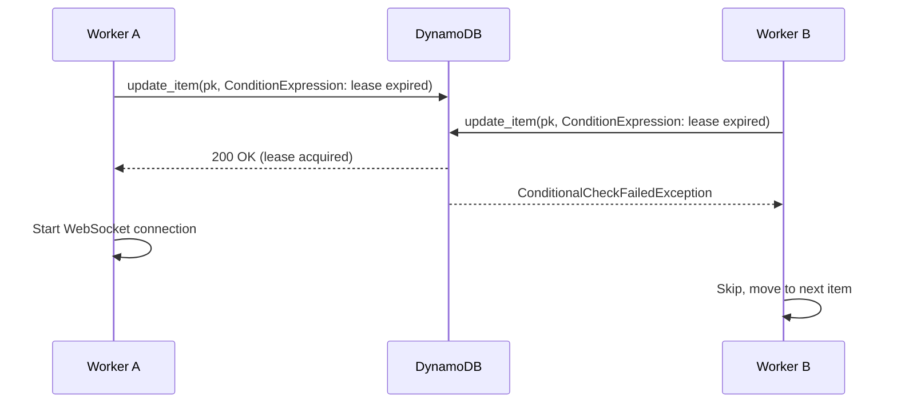
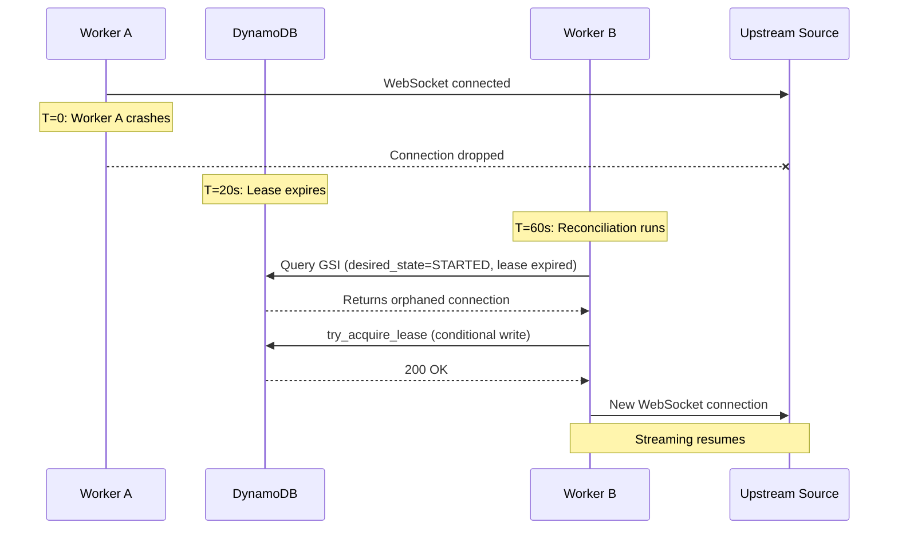
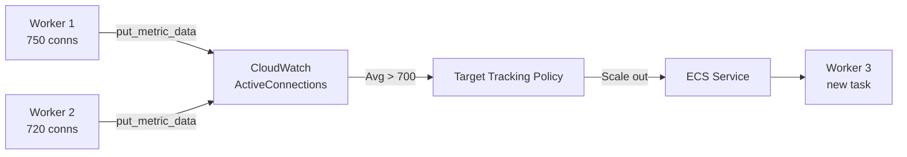

# WebSocket Fleet Management System

> **Disclaimer:** This is sample code for educational purposes. It is not
> production-ready and must be hardened before production use. See
> [SECURITY.md](SECURITY.md) for the list of accepted security trade-offs and
> the required production hardening steps.

Companion repository for the blog post: **"Building Resilient Real-Time Streaming Workers on AWS with ECS Fargate and DynamoDB Leases"**

This system manages hundreds of concurrent outbound WebSocket connections using lease-based coordination, automatic failover, and horizontal auto-scaling.

## Architecture



## How It Works

1. An external system sends a START event via the REST API with a `ws_url`
2. The Event Router Lambda writes the connection record to DynamoDB and queues an SQS message
3. An ECS worker picks up the message, acquires a DynamoDB lease, and opens a WebSocket connection to the upstream source
4. The worker streams incoming messages to a DynamoDB messages table
5. On INTERRUPT, the worker releases its lease and another worker re-acquires the connection
6. On STOP, the worker closes the connection permanently

## Lease Lifecycle

Each WebSocket connection is owned by exactly one worker via a DynamoDB lease. Conditional writes guarantee atomic ownership transitions.



## Lease Acquisition Race Condition

DynamoDB conditional writes ensure exactly one worker wins when multiple workers race for the same connection.



## Failure Recovery

When a worker crashes, its leases expire after 20 seconds. The reconciliation loop on surviving workers detects and re-acquires orphaned connections.



## Auto-Scaling

Workers publish a custom CloudWatch metric (`ActiveConnections`). A target tracking policy scales the ECS service to maintain ~700 connections per task.



## Project Structure

```
.
├── infrastructure/              # Terraform IaC
│   ├── main.tf                  # Root module wiring
│   ├── modules/
│   │   ├── resources/
│   │   │   ├── dynamodb/        # DynamoDB table + GSI
│   │   │   ├── sqs/             # SQS work queue
│   │   │   └── lambda/          # Lambda function packaging
│   │   └── workflows/
│   │       ├── api-gateway/     # HTTP API + authorizer
│   │       ├── ecs-worker/      # Fargate service + auto-scaling
│   │       └── test-ws-server/  # Test transcript WebSocket server
│   ├── variables.tf
│   ├── outputs.tf
│   └── providers.tf
├── src/
│   ├── lambda/
│   │   ├── event_router/        # START/STOP/INTERRUPT handler
│   │   └── authorizer/          # API key validation
│   ├── worker/
│   │   ├── app.py               # Worker: SQS poll, lease, WebSocket, reconcile
│   │   ├── Dockerfile
│   │   └── requirements.txt
│   └── test-ws-server/
│       ├── app.py               # Transcript streaming WebSocket server
│       ├── Dockerfile
│       └── requirements.txt
├── tests/
│   ├── test_flow.py             # End-to-end test script (START/INTERRUPT/STOP)
│   └── websocket_server.py      # Local dev WebSocket server
├── docs/
│   └── DEPLOYMENT.md            # Step-by-step deployment guide
└── deploy.sh                    # Deployment wrapper script
```

## Key Configuration

| Parameter | Value | Rationale |
|-----------|-------|-----------|
| Lease duration | 20s | Fast failover while surviving brief network hiccups |
| Heartbeat interval | 5s | 4x safety margin before lease expiry |
| Reconciliation interval | 60s | Balance recovery speed vs. DynamoDB read cost |
| Max connections/task | 800 | Based on memory/CPU profiling per connection |
| Scale-out cooldown | 2 min | Prevent thrashing during traffic spikes |
| Scale-in cooldown | 15 min | Allow connections to stabilize |

## Getting Started

### Prerequisites

- AWS CLI configured with credentials
- Terraform >= 1.4.0
- Python 3.11+
- Docker

### Deploy

See [docs/DEPLOYMENT.md](docs/DEPLOYMENT.md) for the full step-by-step guide.

```bash
# Set required environment variables
export AWS_DEFAULT_REGION=us-east-1
export TF_BACKEND_BUCKET=<your-terraform-state-bucket>
export TF_BACKEND_DYNAMODB_TABLE=<your-terraform-lock-table>

# Plan and apply
./deploy.sh --action plan
./deploy.sh --action apply
```

### Run the end-to-end test

```bash
export API_URL=<your-api-gateway-url>
export API_KEY=<your-api-key>
python tests/test_flow.py
```

### Send a manual test event

```bash
curl -X POST ${API_URL}/events \
  -H "Content-Type: application/json" \
  -H "x-api-key: ${API_KEY}" \
  -d '{
    "event_type": "START",
    "connection_id": "meeting-123",
    "ws_url": "ws://test-ws-server.ws-fleet-dev.local:8765"
  }'
```

### Local development

```bash
# Start the local WebSocket server (transcript mode)
python tests/websocket_server.py

# Or manual mode (send messages via HTTP API)
python tests/websocket_server.py --mode manual
```

## Security

- API keys are stored in AWS SSM Parameter Store (SecureString) and injected
  as environment variables at deploy time. Keys are never committed to the repo.
- The authorizer Lambda fails closed: if the API_KEY env var is missing,
  all requests are rejected.
- Terraform state is encrypted with KMS in S3 with DynamoDB locking.
- ECS tasks use least-privilege IAM roles scoped to specific DynamoDB tables
  and SQS queues.

See [CONTRIBUTING](CONTRIBUTING.md#security-issue-notifications) for reporting security issues.

## Reporting Issues

Please file a GitHub issue for any bugs or feature requests. All issues will be
prioritized based on resource availability. Pull requests for fixes are welcome.

## Contributions

We welcome community contributions! See [CONTRIBUTING](CONTRIBUTING.md) for
guidelines.

## License

This library is licensed under the MIT-0 License. See the [LICENSE](LICENSE) file.

## Authors

- Siddhesh Tiwari — Data Scientist, AWS Professional Services
- Ajay Raghunathan
- Dustin Whitney
- Chetan Padhiyar - Delivery Consultant, AWS Professional Services
